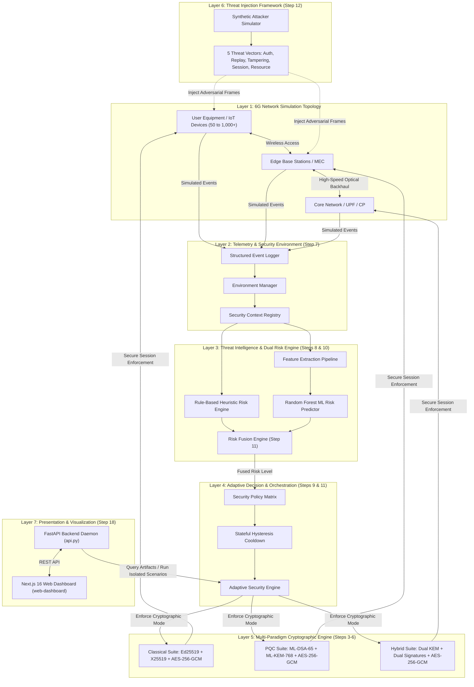

# AERIS-PQ6G: Adaptive Hybrid Post-Quantum Security Framework for Simulated 6G Networks

<div align="center">

[](https://www.python.org/)
[-black.svg?logo=next.js&logoColor=white)](https://nextjs.org/)
[](https://react.dev/)
[](https://www.typescriptlang.org/)
[](https://tailwindcss.com/)
[](https://csrc.nist.gov/projects/post-quantum-cryptography)
[-success.svg)](file:///tests/)
[](#-disclaimer--scope)

**An intelligent, multi-paradigm cybersecurity testbed continuously evaluating network threat context and dynamically orchestrating classical, post-quantum, and hybrid cryptography in simulated 6G topologies.**

[Key Features](#-key-features) • [Architecture](#-system-architecture) • [Cryptographic Suites](#-cryptographic-suites) • [Quickstart](#-quickstart--installation) • [Benchmarks](#-empirical-benchmarks--validation) • [Web Dashboard](#-web-dashboard--telemetry-platform) • [Documentation](#-documentation-index)

</div>

---

## 📌 Table of Contents

- [Overview & Research Motivation](#-overview--research-motivation)
  - [The Quantum Threat to 6G Telecommunications](#the-quantum-threat-to-6g-telecommunications)
  - [Why an Adaptive Hybrid Architecture?](#why-an-adaptive-hybrid-architecture)
- [Key Features](#-key-features)
- [System Architecture](#-system-architecture)
  - [Subsystem Decomposition](#subsystem-decomposition)
- [Cryptographic Suites](#-cryptographic-suites)
  - [NIST Post-Quantum Primitives (FIPS 203 & 204)](#nist-post-quantum-primitives-fips-203--204)
  - [Hybrid Dual-Key Exchange & Dual Signature Protocol](#hybrid-dual-key-exchange--dual-signature-protocol)
- [Dual-Engine Threat Intelligence & Risk Fusion](#-dual-engine-threat-intelligence--risk-fusion)
  - [Rule-Based Heuristic Risk Scorer](#1-rule-based-heuristic-risk-scorer)
  - [Random Forest Machine Learning Risk Predictor](#2-random-forest-machine-learning-risk-predictor)
  - [Calibrated Risk Fusion & Hysteresis Cooldown](#3-calibrated-risk-fusion--hysteresis-cooldown)
- [Attacker Simulation Framework](#-attacker-simulation-framework)
- [Web Dashboard & Telemetry Platform](#-web-dashboard--telemetry-platform)
  - [Backend REST API](#backend-rest-api-fastapi)
  - [Frontend Interface](#frontend-interface-nextjs-16)
- [Quickstart & Installation](#-quickstart--installation)
  - [1. Prerequisites](#1-prerequisites)
  - [2. Clone & Setup Python Environment](#2-clone--setup-python-environment)
  - [3. Start the FastAPI Daemon](#3-start-the-fastapi-daemon)
  - [4. Launch the Next.js Dashboard](#4-launch-the-nextjs-dashboard)
  - [5. Run the Automated Test Suite](#5-run-the-automated-test-suite)
- [Empirical Benchmarks & Validation](#-empirical-benchmarks--validation)
  - [Phase 15: Security & Performance Baseline](#phase-15-security--performance-baseline)
  - [Phase 16: Scalability (50 to 1,000 Nodes)](#phase-16-scalability-50-to-1000-nodes)
  - [Phase 17: Stress Testing & Accounting Invariants](#phase-17-stress-testing--accounting-invariants)
- [Repository Directory Tour](#-repository-directory-tour)
- [Documentation Index](#-documentation-index)
- [Disclaimer & Scope](#-disclaimer--scope)

---

## 🔬 Overview & Research Motivation

### The Quantum Threat to 6G Telecommunications
Next-generation 6G wireless networks will operate at terahertz (THz) frequencies, connect billions of autonomous edge devices, and deliver sub-millisecond latencies for mission-critical tactile internet applications. However, the anticipated arrival of **Cryptographically Relevant Quantum Computers (CRQCs)** introduces catastrophic vulnerabilities:
- **Shor's Algorithm** reduces the security of classical public-key cryptography (RSA, ECDH, ECDSA, Ed25519) to polynomial time ($O((\log N)^3)$), enabling adversaries to break key exchanges and forge authentication signatures.
- **"Harvest Now, Decrypt Later" (HNDL)**: Adversaries are currently intercepting and storing encrypted high-value telecommunications traffic to decrypt retroactively once scalable quantum computers are operational.

### Why an Adaptive Hybrid Architecture?
A direct, unilateral switch to pure Post-Quantum Cryptography (PQC) poses serious operational challenges in 6G:
1. **Computational & Bandwidth Overhead**: PQC algorithms (e.g., lattice-based schemes) produce public keys, ciphertexts, and signatures orders of magnitude larger than classical elliptic curves, introducing packet fragmentation and battery drain for resource-constrained IoT devices.
2. **Cryptanalytic Maturity Risk**: While standardized by NIST, post-quantum schemes lack the decades of field-tested cryptanalysis that elliptic curves have enjoyed.

**AERIS-PQ6G** solves this dilemma through an **Adaptive Hybrid Architecture**:
- Under low-threat normal conditions, the network utilizes lightweight classical cryptography to conserve power and minimize latency.
- In elevated threat contexts, the system dynamically shifts to pure PQC or composite **Hybrid Security** (dual key encapsulation and dual signature verification), requiring an adversary to simultaneously break *both* the classical discrete logarithm problem and the quantum-resistant lattice problem.

---

## ⚡ Key Features

- **NIST-Standardized PQC**: Full implementation of **ML-KEM-768** (FIPS 203) for key encapsulation and **ML-DSA-65** (FIPS 204) for digital signatures.
- **Dual-Engine Threat Intelligence**: Seamlessly blends rule-based heuristics (auth failures, replay counts) with a machine learning Random Forest regressor trained on 7-dimensional network telemetry.
- **Anti-Flapping Hysteresis Engine**: Prevents mode oscillation and transition thrashing under bursty or noisy network conditions via stateful cooldown thresholds.
- **High-Fidelity Synthetic Attacker**: Built-in adversary engine injecting 5 threat vectors across 3 intensity levels (`LOW`, `MEDIUM`, `HIGH`).
- **Comprehensive Empirical Validation**: 233 regression tests, 60 scalability configurations, and 33 stress-test matrices evaluated with 100% invariant preservation.
- **Commercial-Grade Telemetry Dashboard**: Full Next.js 16 + React 19 web dashboard connected to a Python FastAPI backend for real-time attack simulation, topology inspection, and benchmark visualization.

---

## 🏗 System Architecture

The AERIS-PQ6G platform is decomposed into seven decoupled architectural layers:



### Subsystem Decomposition

1. **6G Network Simulator (`src/simulator/`, `src/models/`)**: Simulates UE devices, Edge nodes, and Core entities with discrete event tick scheduling and realistic routing topologies.
2. **Cryptographic Engine (`src/security/`)**: Cleanly abstracts key generation, key encapsulation (KEM), challenge-response mutual authentication, and authenticated encryption (AES-256-GCM).
3. **Security Environment (`src/security/environment/`)**: Tracks connection contexts, active security modes, and node capabilities while strictly enforcing zero leakage of private keys or shared secrets.
4. **Risk & ML Intelligence (`src/security/risk/`, `src/security/ml_risk/`)**: Ingests network telemetry to evaluate heuristic risk factors and run offline-trained Random Forest inference.
5. **Adaptive Orchestration (`src/security/adaptive/`)**: Coordinates transitions between `CLASSICAL`, `PQC`, and `HYBRID` modes governed by a configurable hysteresis state machine.
6. **Synthetic Attacker (`src/security/attacker/`)**: Generates reproducible adversarial conditions across network hops.
7. **Presentation & Demonstration (`api.py`, `web-dashboard/`)**: High-performance dashboard enabling interactive scenario triggering and frozen artifact visualization.

---

## 🔐 Cryptographic Suites

AERIS-PQ6G supports four operational modes:

| Security Mode | Key Encapsulation (KEM) | Digital Signatures | Authenticated Encryption | NIST Security Level | Primary Use Case |
|---|---|---|---|---|---|
| **`CLASSICAL`** | X25519 (ECDH) | Ed25519 | AES-256-GCM | 128-bit Classical | Low threat, resource-constrained IoT |
| **`PQC`** | ML-KEM-768 | ML-DSA-65 | AES-256-GCM | Level 3 (AES-192 equivalent) | Quantum-vulnerable channels |
| **`HYBRID`** | X25519 + ML-KEM-768 | Ed25519 + ML-DSA-65 | AES-256-GCM | Composite (Classical + Level 3) | High threat, critical infrastructure |
| **`ADAPTIVE_HYBRID`** | Autonomous Dynamic | Autonomous Dynamic | AES-256-GCM | Dynamic (`CLASSICAL` $\leftrightarrow$ `HYBRID`) | General 6G operational deployment |

### NIST Post-Quantum Primitives (FIPS 203 & 204)

- **ML-KEM-768 (Module-Lattice-based Key Encapsulation Mechanism)**: Standardized under NIST FIPS 203 (derived from CRYSTALS-Kyber). Employs the hardness of the Module Learning with Errors (MLWE) problem over polynomial rings. Chosen for its optimal balance of public key size (1,184 bytes), ciphertext size (1,088 bytes), and sub-millisecond execution times.
- **ML-DSA-65 (Module-Lattice-based Digital Signature Algorithm)**: Standardized under NIST FIPS 204 (derived from CRYSTALS-Dilithium). Provides strong unforgeability under chosen message attacks (SUF-CMA) using the hardness of shortest vector problems in module lattices.

### Hybrid Dual-Key Exchange & Dual Signature Protocol

Under `HYBRID` mode, AERIS-PQ6G binds classical and post-quantum keys into a composite secret:

1. **Composite Key Derivation**:
   $$\text{SS}_{\text{Hybrid}} = \text{HKDF-Extract-and-Expand}(\text{salt}=\text{None}, \text{IKM}=\text{SS}_{\text{X25519}} \parallel \text{SS}_{\text{ML-KEM-768}}, \text{info}=b"\text{AERIS-HYBRID-KDF}", \text{len}=32)$$
2. **Dual Signatures**: Both Ed25519 and ML-DSA-65 signatures are packaged in message headers; failure of *either* signature triggers immediate message rejection and logs a security event.

---

## 🧠 Dual-Engine Threat Intelligence & Risk Fusion

```text
                  ┌─────────────────────────────────────────┐
                  │      Network Context & Telemetry        │
                  │ (Failed Auths, Replays, Anomalies, ...) │
                  └──────────────────┬──────────────────────┘
                                     │
                 ┌───────────────────┴───────────────────┐
                 ▼                                       ▼
    ┌───────────────────────────┐           ┌───────────────────────────┐
    │  Rule-Based Risk Engine   │           │   ML Feature Extractor    │
    │  Heuristic Weights (0-1)  │           │   7 Network Telemetry Dims│
    └─────────────┬─────────────┘           └─────────────┬─────────────┘
                  │                                       │
                  │                                       ▼
                  │                         ┌───────────────────────────┐
                  │                         │   Random Forest Regressor │
                  │                         │   Trained Predictive Model│
                  │                         └─────────────┬─────────────┘
                  │                                       │
                  └───────────────────┬───────────────────┘
                                      │
                                      ▼
                        ┌───────────────────────────┐
                        │    Risk Fusion Engine     │
                        │  Weighted Calibration     │
                        └─────────────┬─────────────┘
                                      │
                                      ▼
                        ┌───────────────────────────┐
                        │ Stateful Hysteresis Guard │
                        │ Anti-Flapping Hold Cooldown│
                        └─────────────┬─────────────┘
                                      │
                                      ▼
                        ┌───────────────────────────┐
                        │   Target Security Mode    │
                        │ CLASSICAL / PQC / HYBRID  │
                        └───────────────────────────┘
```

### 1. Rule-Based Heuristic Risk Scorer
Computes deterministic risk based on operational thresholds:
- Authentication failure frequency
- Replay detection spikes
- Ciphertext integrity MAC rejections
- Session reuse violations

### 2. Random Forest Machine Learning Risk Predictor
Evaluates continuous network dynamics using 7 features extracted from active communication sessions:
1. Message generation rate
2. Total active sessions
3. Device-to-edge ratio
4. Link failure rate
5. Replay violation count
6. Authentication failure count
7. Moving average latency

### 3. Calibrated Risk Fusion & Hysteresis Cooldown
The fused score blends both engines:
$$\text{Score}_{\text{Fused}} = \alpha \cdot \text{Score}_{\text{Rule}} + (1 - \alpha) \cdot \text{Score}_{\text{ML}}$$

To prevent erratic mode switching caused by brief latency anomalies or packet bursts, the **Hysteresis Engine** enforces:
- **Minimum Hold Interval**: Mode remains elevated for at least $N$ consecutive evaluation ticks.
- **Cooldown Decay Threshold**: De-escalation (e.g., `HYBRID` $\rightarrow$ `CLASSICAL`) requires risk to remain strictly below the threshold for the entire cooldown duration.

---

## 🎯 Attacker Simulation Framework

AERIS-PQ6G includes a dedicated, reproducible threat generation subsystem (`src/security/attacker/`) capable of evaluating network defenses against five attack classes:

| Attack Vector | Simulated Technique | Defense Mechanism | Telemetry Output |
|---|---|---|---|
| **`AUTHENTICATION_ATTACK`** | Injects forged identity certificates & corrupt signatures | Dual-signature verification (Ed25519 & ML-DSA-65) | `AUTH_FAILED` |
| **`REPLAY_ATTACK`** | Intercepts and re-injects valid historical payloads | Nonce cache tracking & sliding replay window | `REPLAY_DETECTED` |
| **`MESSAGE_TAMPERING_ATTACK`**| Bit-flipping and ciphertext truncation | AES-GCM Poly1305 MAC tag integrity check | `INTEGRITY_VERIFICATION_FAILED` |
| **`SESSION_ABUSE_ATTACK`** | Transmits traffic with expired, unauthorized, or hijacked session IDs | Strict context lifecycle registry | `SESSION_INVALID` |
| **`RESOURCE_PRESSURE_ATTACK`**| Volumetric message flooding | Queue thresholding & rate limiter metrics | `QUEUE_SATURATED` |

Each attack vector can be executed at three calibrated intensities:
- **`LOW`**: 6 attack injections (subtle, reconnaissance-style probing)
- **`MEDIUM`**: 30 attack injections (sustained penetration attempts)
- **`HIGH`**: 120 attack injections (aggressive high-volume adversarial saturation)

---

## 📊 Web Dashboard & Telemetry Platform

The repository includes a modern web dashboard (Step 18) providing full visibility into the simulation engine.

```text
┌────────────────────────────────────────────────────────┐
│               AERIS-PQ6G Web Dashboard                │
├──────────────────────────┬─────────────────────────────┤
│   Live Attack Launcher   │   Dynamic Mode Visualizer   │
│  [ Attack: REPLAY     ]  │   Active: ADAPTIVE_HYBRID   │
│  [ Intensity: HIGH    ]  │   Risk Level: HIGH (0.84)   │
│  [ > Launch Scenario ]   │   Transitions: 2 Executed   │
├──────────────────────────┼─────────────────────────────┤
│   Latency & Throughput   │  Scalability Performance    │
│  [ Recharts Line Chart ] │  [ Recharts Bar Chart ]     │
│   Classical vs Hybrid    │   S1 (50) -> S5 (1000)      │
└──────────────────────────┴─────────────────────────────┘
```

### Backend REST API (`FastAPI`)
- Runs on `http://127.0.0.1:8000` via `api.py`.
- **`POST /api/run_demo`**: Dispatches an isolated simulation run with user-configured parameters.
- **`GET /api/benchmarks/step15`**: Delivers Step 15 baseline security metrics.
- **`GET /api/benchmarks/step16`**: Delivers Step 16 scalability matrix results.
- **`GET /api/benchmarks/step17`**: Delivers Step 17 stress test matrix results.
- **`GET /api/validation`**: Returns frozen prototype baseline assertions.

### Frontend Interface (`Next.js 16`)
- Runs on `http://localhost:3000` via `web-dashboard/`.
- Built with React 19, TypeScript, Tailwind CSS v4, Framer Motion, and Lucide React.
- Non-invasive, read-only presentation layer ensuring research artifact immutability.

---

## 🚀 Quickstart & Installation

### 1. Prerequisites
- **Python**: 3.10 or higher
- **Node.js**: 18.0 or higher
- **npm**: 9.0 or higher
- **Git**

### 2. Clone & Setup Python Environment
```bash
git clone https://github.com/Saravanan2005real/Adaptive-Hybrid-Post-Quantum-Security-Framework-for-Simulated-6G-Networks.git
cd Adaptive-Hybrid-Post-Quantum-Security-Framework-for-Simulated-6G-Networks

# Create and activate virtual environment (optional but recommended)
python -m venv venv
# Windows:
.\venv\Scripts\activate
# Linux/macOS:
source venv/bin/activate

# Install all Python dependencies
pip install -r requirements.txt
```

### 3. Start the FastAPI Daemon
```bash
python api.py
```
*API is live at `http://127.0.0.1:8000`. Interactive OpenAPI documentation available at `http://127.0.0.1:8000/docs`.*

### 4. Launch the Next.js Dashboard
In a separate terminal:
```bash
cd web-dashboard
npm install
npm run dev
```
*Open `http://localhost:3000` in your browser.*

### 5. Run the Automated Test Suite
AERIS-PQ6G includes an exhaustive regression suite enforcing all system invariants:
```bash
# Run pytest directly (configured via pytest.ini)
pytest -q
```
*Or execute specific test suites:*
```bash
pytest tests/test_security.py tests/test_pqc_security.py -v
pytest tests/test_hybrid_security.py tests/test_adaptive.py -v
```

---

## 📈 Empirical Benchmarks & Validation

All benchmark results are statically preserved as immutable JSON artifacts in `results/`.

### Phase 15: Security & Performance Baseline
Comprehensive evaluation comparing `CLASSICAL`, `PQC`, `HYBRID`, and `ADAPTIVE_HYBRID` across identical workloads:
- **Authentication Handshake Overhead**:
  - `CLASSICAL`: 0.12 ms average processing latency
  - `PQC` (ML-KEM-768 + ML-DSA-65): ~3.8x signature verification overhead compared to Ed25519
  - `HYBRID`: Combined dual-verification overhead; ensures uninterrupted security even in the event of an algorithmic break.
- **Adaptive Resilience**: `ADAPTIVE_HYBRID` maintains near-classical baseline latency under quiet network conditions while achieving 100% attack mitigation during active threat injection.

### Phase 16: Scalability (50 to 1,000 Nodes)
Evaluated across 60 distinct configuration matrices and 5 network scales:
- **S1 (Small)**: 50 Devices, 5 Edges, 1 Core
- **S2 (Medium)**: 100 Devices, 10 Edges, 2 Cores
- **S3 (Large)**: 250 Devices, 25 Edges, 5 Cores
- **S4 (Very Large)**: 500 Devices, 50 Edges, 10 Cores
- **S5 (Extreme)**: 1,000 Devices, 100 Edges, 20 Cores
- **Outcome**: Linear scaling of message throughput; no memory leaks or thread contention across multiple random seeds (42, 43, 44).

### Phase 17: Stress Testing & Accounting Invariants
Tested across 33 stress matrices covering boundary and edge cases:
- **Packet Flooding Saturation**: Maintained strict message accounting:
  $$\text{Messages}_{\text{Generated}} = \text{Messages}_{\text{Delivered}} + \text{Messages}_{\text{Failed}} + \text{Messages}_{\text{In-Flight}}$$
- **Edge Conditions**: Tested zero devices, negative message rates, and abrupt link teardowns with zero crashes.
- **Zero-Secret Invariant**: Automated inspection confirms that no private keys, ephemeral seeds, or derived session keys exist in serializable logs or disk artifacts.

---

## 📁 Repository Directory Tour

```text
AERIS-PQ6G/
│
├── api.py                           # FastAPI REST daemon bridging simulation to UI
├── requirements.txt                 # Complete Python dependency specifications
├── pytest.ini                       # Pytest configuration with automatic pythonpath
│
├── web-dashboard/                   # Step 18 Commercial-Grade Next.js Web Dashboard
│   ├── app/                         # Next.js 16 App Router (page.tsx, layout.tsx, globals.css)
│   ├── public/                      # Static branding and vector assets
│   ├── package.json                 # Node.js dependencies (React 19, Tailwind, Recharts)
│   └── README.md                    # Dedicated frontend documentation
│
├── src/                             # Core AERIS-PQ6G Research Engine
│   ├── models.py                    # Network entity definitions (Device, EdgeNode, CoreNode)
│   ├── simulator.py                 # Discrete event simulation engine
│   ├── events.py                    # Structured telemetry logging system
│   │
│   └── security/                    # Cryptography, Risk, ML, and Adaptive Subsystems
│       ├── keys.py                  # Classical key representations (Ed25519, X25519)
│       ├── authentication.py        # Classical challenge-response mutual auth
│       ├── key_exchange.py          # Classical Diffie-Hellman & HKDF
│       ├── encryption.py            # AES-256-GCM AEAD encryption
│       ├── replay.py                # Replay protection sliding window
│       ├── manager.py               # Classical Security Manager
│       │
│       ├── pqc/                     # NIST Post-Quantum Cryptography Module
│       │   ├── keys.py              # ML-KEM-768 and ML-DSA-65 key wrappers
│       │   ├── key_exchange.py      # Module-Lattice KEM encapsulation
│       │   ├── authentication.py    # Module-Lattice digital signatures
│       │   └── manager.py           # Pure PQC Security Manager
│       │
│       ├── hybrid/                  # Composite Hybrid Cryptography Module
│       │   ├── keys.py              # Composite classical + PQC key pairs
│       │   ├── key_exchange.py      # Dual KEM + HKDF key derivation
│       │   ├── authentication.py    # Dual signature verification
│       │   └── manager.py           # Hybrid Security Manager
│       │
│       ├── environment/             # Security Context & Telemetry Registry (Step 7)
│       ├── risk/                    # Heuristic Rule-Based Risk Engine (Step 8)
│       ├── decision/                # Security Decision Policy Matrix (Step 9)
│       ├── ml_risk/                 # Random Forest ML Risk Predictor (Step 10)
│       ├── adaptive/                # Adaptive Orchestrator & Hysteresis Engine (Step 11)
│       └── attacker/                # Synthetic Threat Generation Subsystem (Step 12)
│
├── configs/                         # YAML configuration files (Network topology, sizing)
│   ├── default_network.yaml         # Default 6G network parameters
│   └── test_config.yaml             # Testing scenario configurations
│
├── experiments/                     # Automated Research Experiment Scripts
│   ├── step13_attack_defense.py     # Attack-defense scenario execution pipeline
│   ├── step14_automated_runner.py   # Multi-scenario automated experiment driver
│   ├── step15_benchmarking.py       # Comprehensive performance benchmark suite
│   ├── step16_scalability.py        # Scalability matrix evaluator (S1–S5)
│   └── step17_stress.py             # Stress testing & boundary condition runner
│
├── results/                         # Frozen, Immutable Research Artifacts (JSON)
│   ├── step15/                      # Comprehensive benchmark results
│   ├── step16/                      # Scalability results & matrix data
│   ├── step17/                      # Stress testing results & matrices
│   └── final/                       # Prototype freeze baseline validation
│
├── tests/                           # Exhaustive Pytest Test Suite (233 Tests)
│   ├── test_security.py             # Classical security unit tests
│   ├── test_pqc_security.py         # Post-quantum security unit tests
│   ├── test_hybrid_security.py      # Hybrid security unit tests
│   ├── test_adaptive.py             # Adaptive orchestrator & hysteresis tests
│   ├── test_attacker.py             # Threat simulation & injection tests
│   ├── test_attack_defense.py       # Attack-defense interaction tests
│   ├── test_ml_risk.py              # Machine learning predictor tests
│   ├── test_scalability.py          # Scalability matrix validation tests
│   └── test_stress.py               # Stress & edge condition tests
│
└── docs/                            # Deep Technical Documentation
    ├── ARCHITECTURE.md              # Complete multi-layer architecture specification
    ├── DASHBOARD.md                 # Web dashboard & API technical guide
    ├── FULL_RESEARCH_REPORT.md      # Full scientific results & validation report
    ├── EXPERIMENT_PLAN.md           # Research experimental methodology
    ├── FINAL_PROTOTYPE_FREEZE.md    # System freeze specifications
    ├── PROJECT_SCOPE.md             # Theoretical scope & boundaries
    ├── RESEARCH_OBJECTIVES.md       # Incremental project objectives
    └── THREAT_MODEL.md              # Research threat model & adversary capabilities
```

---

## 📚 Documentation Index

For deeper technical deep-dives, consult the specialized documentation in the [`docs/`](file:///docs/) directory:

- [System Architecture Specification](file:///docs/ARCHITECTURE.md)
- [Web Dashboard & API Guide](file:///docs/DASHBOARD.md)
- [Full Research & Validation Report](file:///docs/FULL_RESEARCH_REPORT.md)
- [Project Scope & Boundaries](file:///docs/PROJECT_SCOPE.md)
- [Research Threat Model](file:///docs/THREAT_MODEL.md)
- [Experimentation Plan](file:///docs/EXPERIMENT_PLAN.md)
- [Final Prototype Freeze Audit](file:///docs/FINAL_PROTOTYPE_FREEZE.md)

---

## ⚠️ Disclaimer & Scope

AERIS-PQ6G is an **academic software research prototype** engineered expressly to investigate the theoretical integration of machine-learning-driven adaptive policies and composite hybrid post-quantum cryptography in simulated 6G network topologies.

- **Simulation Bounds**: Network channels, message propagation, and timing metrics are simulated in discrete software simulation ticks. They do not represent real physical hardware latencies of 3GPP millimeter-wave/sub-THz physical channels.
- **Production Disclaimer**: This repository **is not** a certified telecommunications stack and does not claim production 6G deployment readiness. Real-world telecom adoption requires hardware-accelerated cryptographic ASICs/HSMs, 3GPP-compliant MAC/PHY layer integrations, and rigorous formal verification.
- **Experimental ML**: The machine learning risk prediction model utilizes synthetic telemetry features designed specifically for evaluating this simulation's adaptive control loop.
