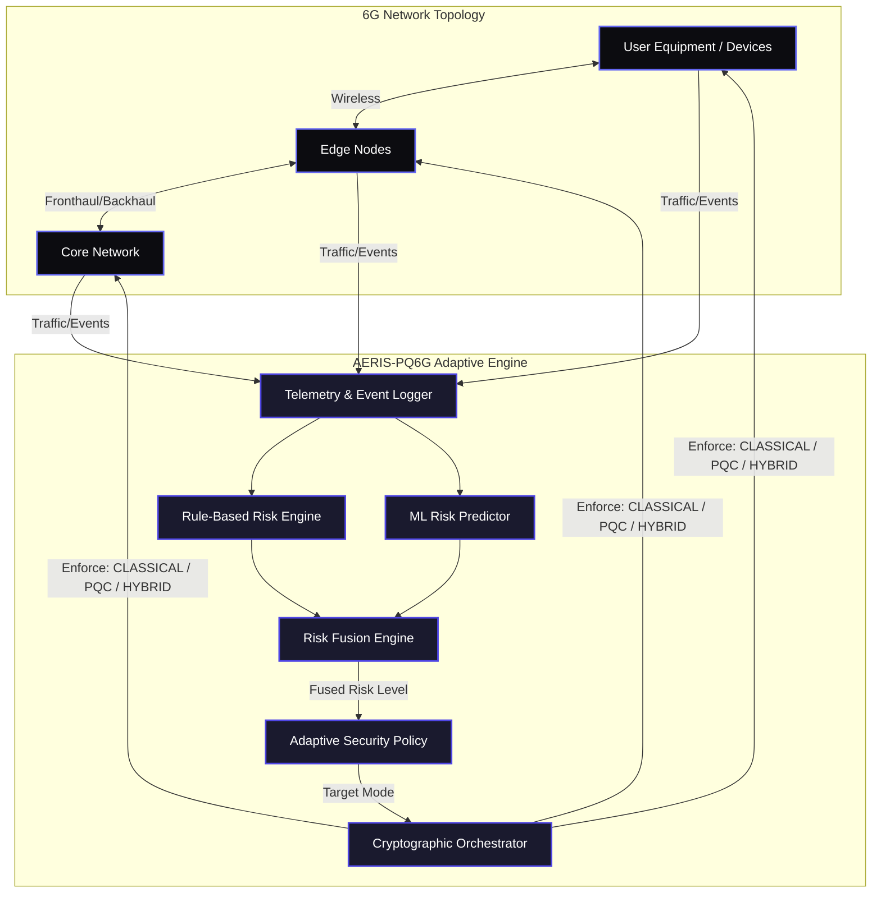

# AERIS-PQ6G

> **Adaptive Security Infrastructure for Next-Generation Networks**

AERIS-PQ6G is a highly sophisticated, research-oriented software prototype designed to evaluate the integration of post-quantum cryptography (PQC) and machine learning (ML)-driven adaptive security mechanisms into simulated 6G network environments.

As quantum computing matures, classical cryptographic algorithms currently securing telecommunication networks will become vulnerable. 6G networks, characterized by ultra-low latency, massive connectivity, and high heterogeneity, require security frameworks that are not only quantum-resistant but also highly adaptive and performant under varying network conditions. AERIS-PQ6G continuously evaluates network risk and dynamically orchestrates classical, post-quantum, and hybrid security to ensure robust protection against quantum adversaries and optimal performance.

---

## 🏗 Core Architecture

The platform operates across several tightly integrated subsystems, rigorously isolated by architectural boundaries.



### 1. Network Simulation Framework
A purely architectural/protocol simulation emulating a massive-scale 6G topology.
- **Components**: Devices (UE), Edge Nodes, Core Network Elements.
- **Topologies**: Configurable scaling from 50 to 1,000+ nodes using YAML configurations.

### 2. Cryptographic Engine
Implements modular cryptographic strategies evaluated in real-time.
- **CLASSICAL**: Employs industry-standard non-PQC primitives (ED25519, AES-GCM).
- **PQC**: Pure post-quantum cryptography integrating NIST-standardized algorithms (ML-KEM-768 for encapsulation, ML-DSA-65 for signatures).
- **HYBRID**: Fuses classical and PQC keys, ensuring protection even if one underlying mathematical foundation is broken.

### 3. Intelligence & Risk Fusion
- **Rule-Based Risk**: Deterministic heuristics derived from real-time telemetry (authentication failures, latency spikes).
- **ML Risk Predictor**: Machine learning classification (Random Forest) trained on historical network features to predict complex threat behaviors.
- **Risk Fusion**: Blends Rule and ML risk into a unified, actionable risk score (LOW, MEDIUM, HIGH, CRITICAL).

### 4. Adaptive Security Orchestration
The heart of AERIS-PQ6G. The `AdaptiveSecurityEngine` ingests fused risk scores and enforces automated security posture transitions (e.g., dynamically elevating a connection from `CLASSICAL` to `HYBRID` when a high-intensity attack is detected).

### 5. Controlled Threat Simulation
A built-in experimental attacker framework capable of generating high-fidelity threat scenarios:
- **Authentication Attacks**: Forging credentials.
- **Replay Attacks**: Capturing and resending valid payloads.
- **Message Tampering**: Integrity compromise attempts.
- **Session Abuse**: Hijacking active contexts.
- **Resource Pressure**: Volumetric packet floods mimicking DoS.

---

## ⚛️ Post-Quantum Cryptography (PQC) Integration

AERIS-PQ6G specifically implements the NIST-standardized cryptographic algorithms designed to withstand attacks from large-scale quantum computers.

### Key Encapsulation Mechanism (KEM)
**ML-KEM-768 (Module-Lattice-based Key-Encapsulation Mechanism)**
- *Formerly known as CRYSTALS-Kyber.*
- Used for secure key establishment and exchange over public channels.
- Relies on the hardness of the Module Learning with Errors (MLWE) problem.
- **Why 768?** ML-KEM-768 provides NIST Security Level 3 (equivalent to AES-192), offering the optimal balance between quantum resistance, ciphertext size, and ultra-low latency required for 6G topologies.

### Digital Signatures
**ML-DSA-65 (Module-Lattice-based Digital Signature Algorithm)**
- *Formerly known as CRYSTALS-Dilithium.*
- Used for authentication and verifying the integrity of network contexts.
- Relies on the hardness of finding short vectors in lattices.
- **Why 65?** ML-DSA-65 maps to NIST Security Level 3. It provides strong unforgeability under chosen message attacks (SUF-CMA) with highly efficient verification times, critical for massive IoT device onboarding in 6G.

### Hybrid Cryptography (The Fused Approach)
Migrating directly to pure PQC introduces systemic risk if a mathematical flaw is discovered in the new lattice algorithms. AERIS-PQ6G implements **Hybrid Security Mode**, which structurally combines:
- **Classical** (X25519 / ED25519) + **PQC** (ML-KEM-768 / ML-DSA-65)
The resulting keys and signatures ensure that an adversary must break *both* the classical discrete logarithm problem *and* the quantum-resistant lattice problem to compromise the connection.

---

## 📂 Repository Structure

The repository has been meticulously organized to enforce separation of concerns between core logic, experiments, and the presentation layer.

```text
AERIS-PQ6G/
│
├── api.py                   # FastAPI backend bridging the research engine to the UI
├── web-dashboard/           # Commercial-grade Next.js React frontend
│
├── src/                     # Core AERIS-PQ6G implementation
│   ├── simulator/           # Network topology simulation
│   ├── events/              # Event logging and telemetry
│   └── security/            # Cryptography, ML Risk, Adaptive Orchestrator, Attacker
│
├── configs/                 # YAML configuration files (Network sizing, ML parameters)
├── data/                    # Synthetic telemetry datasets for ML training
├── results/                 # Immutable, frozen benchmark artifacts (JSON)
│   ├── step15/              # Comprehensive security metrics
│   ├── step16/              # Scalability execution metrics
│   ├── step17/              # Stress test matrices
│   └── final/               # Baseline freeze state
│
├── experiments/             # Automated research scripts evaluating specific subsystems
├── tests/                   # Pytest suite enforcing system invariants and regression
└── docs/                    # Architectural documents and phase reports
```

---

## 🚀 Running the Platform

The AERIS-PQ6G platform is designed with a pristine split between the deep Python research engine and a commercial-grade Next.js web application.

### 1. Prerequisites
- **Python 3.10+**
- **Node.js 18+**

### 2. Start the FastAPI Backend
The Python backend wraps the authentic `experiments.step13_attack_defense.run_experiment_scenario` pipeline to securely serve simulations without duplicating research logic.
```bash
# Install Python dependencies
pip install -r requirements.txt
pip install fastapi uvicorn

# Start the API daemon
python api.py
```
*The backend will run locally on `http://127.0.0.1:8000`.*

### 3. Start the Next.js Frontend
The frontend provides a breathtaking, interactive visualization of the underlying simulation.
```bash
cd web-dashboard

# Install React dependencies
npm install

# Start the development server
npm run dev
```
*Access the commercial dashboard at `http://localhost:3000`.*

---

## 🧪 Testing & Validation

AERIS-PQ6G enforces absolute code integrity via a comprehensive, frozen regression suite. 

To run the validation test suite:
```bash
# Set Python path and run pytest quietly
$env:PYTHONPATH="."
pytest -q
```
**Validation Evidence:**
- **233** Full Regression Tests
- **60** Validated Scalability Configurations
- **48** Automated Experiment Runs
- **33** Stress-Test Matrices Evaluated

*(Note: The immutable artifacts generated during Phase 15–17 benchmarking are committed into `results/` and must not be altered.)*

---

## ⚠️ Disclaimer

AERIS-PQ6G is an **experimental research prototype**. It is expressly engineered to demonstrate the *theoretical integration* of ML-based adaptive policies and hybrid post-quantum cryptography in simulated high-density (6G) networks. 

It **is not** a production-ready telecommunications stack. Real-world implementations require extensive hardware offloading, 3GPP-compliant physical/MAC layer integrations, and cryptographically verified low-level primitives. No claims of "unhackable" or "production security" are made outside the bounds of this controlled software simulation.
