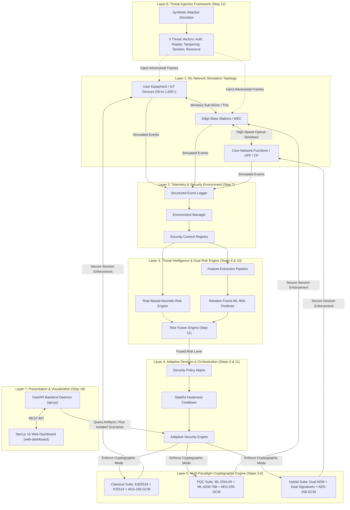

# AERIS-PQ6G System Architecture

> **Adaptive Hybrid Post-Quantum Security Framework for Simulated 6G Networks**

AERIS-PQ6G is a multi-tier, modular software simulation prototype designed for experimental research at the intersection of Post-Quantum Cryptography (PQC), Machine Learning-driven threat intelligence, and next-generation 6G network topologies.

---

## 🏛 High-Level Architecture

The framework is structured into clean, decoupled layers enforcing strict separation of concerns, isolation of cryptographic secrets, and deterministic simulation reproducibility.

---

## 🧩 Architectural Subsystems

### 1. 6G Network Topology Simulation (`src/simulator/`, `src/models/`)
- **Node Entities**: User Equipment (`Device`), Multi-Access Edge Computing (`EdgeNode`), and Centralized Network Functions (`CoreNode`).
- **Configurable Scalability**: Supports synthetic topologies ranging from S1 (50 devices, 5 edges, 1 core) to S5 (1,000 devices, 100 edges, 20 cores).
- **Discrete Event Tick Engine**: Message dispatching, hops, delivery acknowledgement, and link failure simulation are calculated per discrete simulation tick.

### 2. Cryptographic Engine (`src/security/`)
A modular cryptographic layer providing three swappable paradigms:
- **`CLASSICAL`**:
  - Signatures: **Ed25519** (`cryptography.hazmat.primitives.asymmetric.ed25519`)
  - Key Exchange: **X25519** Diffie-Hellman + HKDF-SHA256 session key derivation
  - Authenticated Encryption: **AES-256-GCM** with 96-bit unique nonces
- **`PQC` (Post-Quantum)**:
  - Signatures: **ML-DSA-65** (NIST FIPS 204, Module-Lattice Digital Signatures)
  - Key Encapsulation: **ML-KEM-768** (NIST FIPS 203, Module-Lattice KEM)
  - Encryption: **AES-256-GCM** with quantum-safe derived symmetric keys
- **`HYBRID`**:
  - Fuses classical and post-quantum keys via composite key derivation:
    $$\text{SharedSecret}_{\text{Hybrid}} = \text{HKDF}(\text{SS}_{\text{X25519}} \parallel \text{SS}_{\text{ML-KEM-768}})$$
  - Dual signature verification: both Ed25519 and ML-DSA-65 signatures must validate.
  - Zero-compromise resilience: guarantees security even if either classical discrete logs or lattice problems are computationally compromised.

### 3. Security Environment & Context Tracking (`src/security/environment/`)
- Acts as the central registry tracking active identities, node capabilities, and connection contexts.
- **Strict Invariant**: Private keys, ephemeral secrets, and symmetric session keys are strictly isolated in memory and NEVER logged to event logs or serializable JSON state.

### 4. Dual Threat Intelligence & Risk Fusion (`src/security/risk/`, `src/security/ml_risk/`, `src/security/adaptive/fusion.py`)
- **Rule-Based Engine**: Computes instantaneous risk from heuristic metrics (authentication failure rates, replay detection frequencies, message integrity violations).
- **ML Risk Predictor**: Evaluates a trained Random Forest regressor on 7 extracted network telemetry features (message generation rate, active sessions, error rates, etc.) to output predictive risk scores.
- **Risk Fusion Engine**: Computes a calibrated weighted blend:
  $$\text{Risk}_{\text{Fused}} = \alpha \cdot \text{Risk}_{\text{Rule}} + (1 - \alpha) \cdot \text{Risk}_{\text{ML}}$$
  Maps into four categorical bands: `LOW`, `MEDIUM`, `HIGH`, `CRITICAL`.

### 5. Adaptive Security Orchestrator (`src/security/adaptive/`)
- Coordinates security mode transitions:
  - `LOW` $\rightarrow$ `CLASSICAL` (minimal CPU and bandwidth overhead)
  - `MEDIUM` $\rightarrow$ `PQC` (quantum-safe posture)
  - `HIGH` / `CRITICAL` $\rightarrow$ `HYBRID` (maximum redundancy and defense-in-depth)
- **Hysteresis Cooldown Engine**: Enforces transition hold-off periods and consecutive evaluation thresholds to prevent rapid flapping between security modes under noisy network conditions.

### 6. Attacker Simulation Framework (`src/security/attacker/`)
Simulates 5 distinct threat classes across configurable intensities (`LOW`, `MEDIUM`, `HIGH`):
1. **`AUTHENTICATION_ATTACK`**: Injects forged identities and invalid signature proofs.
2. **`REPLAY_ATTACK`**: Captures legitimate handshake/data frames and replays them across sessions.
3. **`MESSAGE_TAMPERING_ATTACK`**: Mutates ciphertext payloads to test AEAD integrity rejection.
4. **`SESSION_ABUSE_ATTACK`**: Attempts unauthorized message transmission over stale/invalid session IDs.
5. **`RESOURCE_PRESSURE_ATTACK`**: Simulates volumetric message flooding to induce queue saturation.

### 7. Step 18 Web Dashboard & API (`api.py`, `web-dashboard/`)
- **FastAPI Daemon**: Exposes non-mutating endpoints to query frozen empirical results (Steps 15, 16, 17) and run on-demand isolated attack scenarios via `experiments.step13_attack_defense`.
- **Next.js Frontend**: High-performance dashboard built with React 19, TypeScript, Tailwind CSS, Framer Motion, and Recharts. Provides live scenario triggering, mode transition animations, and telemetry visualizations.

---

## 🔒 Security & Research Boundaries

1. **Software Simulation Testbed**: All nodes, radio channels, and link latencies are simulated in discrete software ticks.
2. **Deterministic Reproducibility**: Random seed management ensures identical, bit-for-bit reproducible runs across all 60 scalability matrices and 33 stress tests.
3. **Zero Secret Leakage**: The telemetry logging subsystem enforces assertion checks verifying that sensitive keys (`private_key`, `session_key`, `shared_secret`) are excluded from logs and artifacts.
